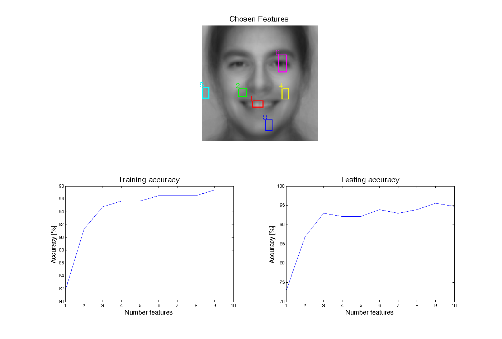

# Classifying Facial Expressions

How can we teach a computer to see? In this exercise, we will take a small step towards this ambitious goal, by building a model that can identify whether someone is smiling from an image.

In a computer, an image is usually stored using a fixed rectangular grid of pixels, where each grid element stores three 'RGB' values, which measure how much red, green and blue each pixel contains. For greyscale images, storing images is simpler, each grid element simply measures how bright the pixel is, e.g. 0 for black, and 1 for white.

In this exercise, we will solely work with greyscale images that have a fixed width of 128 pixels and a height of 128 pixels. We will use the notation $X$ to refer to the grid of pixel values.

Note: In mathematical notation, we often write $X \in \mathbb{R}^{128 \times 128}$ to indicate that $X$ is a 128×128 grid (*matrix*) of real numbers.

**Objective:** Build a system that classifies face images as either *smiling* or *neutral*. The goal is to build a classifier that takes the image matrix $X$ and produces an output $y = 1$ ('Yes') if the image contains a person smiling, and $y = 0$ ('No') otherwise.

## Data

For this exercise, we will use face images collected from three public-domain face databases: the AR Face Database (Aleix Martinez, Purdue), the Yale database, and the Stirling database. To develop and evaluate our model, the images have been randomly divided into a training set (115 images) and a test set (114 images). The faces were prepared by manually selecting four points (eyes and mouth corners) and estimating a similarity transformation to warp the images onto a mean image.

The training dataset is shown below with the manually-annotated facial expressions overlaid. Do you agree with the annotations?

  <button id="tabTrain" aria-pressed="true">Training set (115)</button>
  <button id="tabTest" aria-pressed="false"
          title="The test set stays hidden until Step 4 — click to find out why">
    🔒 Test set (114)</button>

## Step 1 — Feature selection

It's first useful to think about the **features** we rely on to recognise a smile as humans. In the examples above, common features of smiling include:

- Lips curved upwards.
- Raised eyebrows.
- Indented cheeks.
- Teeth on show.

These features are clearer in the images below, which show the **average neutral** (left) and **average smiling** (right) images. Each pixel in these images is an average calculated over the training set. For example, the bottom-left pixel of the average neutral image is calculated by taking the average over all bottom-left pixels from images containing neutral expressions.

<!-- Not all of the features listed above are always present in a smiling image. Can you spot examples where one or more features is missing from an image in the training set? -->

It is easy for us to look at an image and identify features such as whether teeth are on show, but how can we calculate this mathematically from a computer image?

We will use a simple method to calculate features of an image that are correlated with smiling. To do this, we will select different rectangles within the image, and use the average pixel value within each rectangle as a feature to our model. (Later in the practical we will use more than 2 features to improve our model.)

#### Task

Select a set of rectangles for the features: each rectangle should
identify a face region which *differs* between the two classes. The feature computed
from each rectangle is its **mean grey level**.

- Choose a feature slot: 1–2, below.
- **Click and drag** on either face to draw a rectangle.
- Repeat for the second slot. You can change an existing rectangle by re-drawing with the same feature slot selected.

<canvas id="selCanvas" tabindex="0" aria-label="Feature selection canvas: mean neutral and mean smiling faces"></canvas>

  <button id="loadRef">Load reference rectangles</button>
  <button id="clearAll">Clear all</button>

## Step 2 — Feature visualisation

By selecting rectangles and calculating the average pixel value in each rectangle, we have transformed each image into a set of **features**. We will use the notation $z_1$ and $z_2$ to refer to the two feature values calculated from the pixels within the two rectangles, and $\mathbf{z} = [z_1, z_2]$ to refer to the collection of feature values.

In machine learning, a collection of feature values $\mathbf{z}$ is commonly known as a **feature vector**.

<!-- and we can write this mathematically as $z = f(X)$, where $X$ is the image, $z$ is the feature vector, and $f$ is the function that transforms $X$ into $z$, i.e. the function that calculated the average values within the rectangles. -->

Why is this useful? The original greyscale image $X$ consisted of 128×128=16,384 pixels. From these 16,384 numbers we want to produce a single 1/0 output (Yes or No) that tells us whether the image contains a smiling face. By calculating a small number of features, we have dramatically simplified this problem. Transforming each image $X$ into $N = 2$ features is particularly helpful: we can visualise the entire training set of images on a scatter plot, where each image is a single point $(z_1, z_2)$ in a 2-D plot, coloured by whether it is smiling or neutral:

Select rectangles (or load the reference set) to see the feature space here.

  + neutral (training)
  × smiling (training)

Go back to Step 1 and watch how the separation changes as you vary the features. Which rectangles are most helpful to separate neutral and smiling expressions? Are any surprising?

Further reading: dimensionality reduction and overfitting

The number of values needed to describe an input is called its *dimensionality*:
the dimensionality of the image $X$ is 16,384, while the feature vector $\mathbf{z}$ has
dimensionality $N = 2$. In machine learning, if the dimensionality of the input is much
larger than the number of labelled examples (we have only 115 training images!), then a
model trained on the data is often at risk of **overfitting**: performing
well on the training data but poorly on unseen test data. By transforming the
16,384-dimensional image into a small set of features $\mathbf{z}$, we greatly reduce
this risk. This process of using human knowledge to perform dimensionality reduction is
known as **feature engineering** in the ML literature.

To see why models with many parameters can overfit, it is easiest to think about
polynomials. Any 3 datapoints $(x, y)$ can be fitted *exactly* by a quadratic,
and in general any $N$ points can be fitted exactly by a polynomial of degree $N - 1$ —
the curve simply memorises the data, wiggling through every point, rather than capturing
the underlying trend. A classifier whose input has more dimensions than there are
training examples can "memorise" the training set in the same way.

## Step 3 — Fit a classifier by hand

How can a computer decide which class a point belongs to? We will use a simple linear classifier to do this. With two inputs, $z_1$ and $z_2$, a linear classifier works by defining a **straight line** through feature space: points on one side are classified as smiling, points on the other side as neutral. To build the classifier, we choose two *weights* $w_1, w_2$ and a *bias* $b$, and for each point compute the number $w_1 z_1 + w_2 z_2 + b$. The classifier's output $\hat{y}$ depends on the **sign** of this number:

$$\hat{y} = \begin{cases} 1 \; \text{(smiling)} & \text{if } w_1 z_1 + w_2 z_2 + b > 0 \\ 0 \; \text{(neutral)} & \text{if } w_1 z_1 + w_2 z_2 + b \le 0 \end{cases}$$

Here we use the notation $\hat{y}$ for the classifier output, which is an estimate of the ground-truth label $y$. The **line** drawn in the plot below is where this expression is exactly **zero**:

$$w_1 z_1 + w_2 z_2 + b = 0$$

This line is called the *decision boundary*, because it is where the classification flips from one class to the other. On one side of the line the expression is positive (the red arrow), on the other side it is negative (the blue arrow).

#### Task

Move the sliders to change $w_1$, $w_2$ and $b$, and try to find the line that classifies as much of the training set correctly as possible.

- How does each slider change the line?
- What is the best accuracy you can reach by hand?

  <label>w₁ <input type="range" id="mw0" min="-20" max="20" step="0.1" value="5"></label>
  <label>w₂ <input type="range" id="mw1" min="-20" max="20" step="0.1" value="5"></label>
  <label>b <input type="range" id="mb" min="-20" max="20" step="0.1" value="-5"></label>

What you now have is a simple mathematical formula for automatically identifying smiling faces from images, albeit a much less accurate one than you have in your own brain!

## Step 4 — Add a third feature

How can we make our classifier better? Two features are rarely enough. Let's try adding another below, choose
slot 3 and draw a third rectangle:

<canvas id="selCanvas2" tabindex="0" aria-label="Feature selection canvas (three or more slots): mean neutral and mean smiling faces"></canvas>

  <button id="loadRef2">Load reference rectangles</button>
  <button id="clearAll2">Clear all</button>

With $N = 3$ features, every image can be visualised as a point in a **3-D** feature space, and the decision boundary of a linear classifier is no longer a line but a **plane**. Rotate the plot below to see the structure of the data. Can you tweak the parameters of the plane to separate smiling and neutral images?

Select rectangles (or load the reference set) to see the feature space here.

  

    + neutral (training)
    × smiling (training)
  

  

  <canvas id="scatter3d" aria-label="3-D feature space scatter plot; drag to rotate"></canvas>
  
Try to place the plane by hand, as you did with the line — now there are four numbers to tune:

  

    <label>w₁ <input type="range" id="pw0" min="-20" max="20" step="0.1" value="5"></label>
    <label>w₂ <input type="range" id="pw1" min="-20" max="20" step="0.1" value="5"></label>
    <label>w₃ <input type="range" id="pw2" min="-20" max="20" step="0.1" value="5"></label>
    <label>b <input type="range" id="pb" min="-20" max="20" step="0.1" value="-8"></label>
  

  

With two features, there were three parameters that we needed to tune: $w_1, w_2$ and a *bias* $b$. With three features, there are now *four* numbers to tune ($w_1, w_2, w_3, b$). As we add more and more parameters to our model, it becomes increasingly difficult to manually find the optimal parameters of our classifier. Models like ChatGPT have **trillions** of parameters. We need a way for the computer to find the best weights **automatically**.

## Step 5 — Train the classifier with gradient descent

In general, as we add more features, the equation that describes the decision boundary of a linear classifier is given by:

$$w_1 z_1 + w_2 z_2 + \cdots + w_N z_N + b = 0$$

where $N$ is the number of features. This can be written in vector notation as $\mathbf{w}^\top \mathbf{z} = 0$, where $\mathbf{w} = [w_1, \ldots, w_N, b]$ is a vector of the parameters and $\mathbf{z} = [z_1, \ldots, z_N, 1]$ is the feature vector with a 1 appended. In machine learning, these parameters are often known as the model 'weights', hence the letter $\mathbf{w}$ is often used.

To automatically find better parameters, we first need a metric that measures how 'good' a given set of weights are. To do this, we define a **loss function** $E$. In this exercise, our loss function is the sum of squared differences between the classifier's outputs $\hat{y}$ and the true 0/1 labels $y$ over all examples in our training set $\mathcal{D}$. We can write this mathematically as:

$$E = \sum_{\mathcal{D}} (y - \hat{y})^2$$

For a perfect classifier, $y = \hat{y}$ for all examples, and $E$ will be equal to zero. This is just one of many different loss functions used in machine learning. Can you think of any alternatives that might also work?

Now that we have a metric, next we need a method to optimise our weights $\mathbf{w}$. A very popular method to do this is known as **gradient descent**. Every large language model, including ChatGPT, is trained using a variant of this method.

How does it work? Much like our feature vector $\mathbf{z}$, we can also think of the weights $\mathbf{w}$ as representing a point in an N-dimensional space. From an initial set of weights, gradient descent uses *differentiation* to calculate the direction in that space that $\mathbf{w}$ should move in to decrease the loss function $E$. We then take a small step in that direction.

Writing $\mathbf{w}_t$ for the weights after $t$ updates, the equation for one step of gradient descent is:

$$\mathbf{w}_{t+1} = \mathbf{w}_t - \eta \nabla \mathbf{w}_t$$

Reading the equation piece by piece:

- $\mathbf{w}_{t+1}$ are the updated weights after step $t + 1$.
- $\mathbf{w}_t$ are the current weights at step $t$.
- $\eta$, is the **learning rate**, which determines how big each update is: too small and training needs many iterations; too large and the weights and never settle.
- $\nabla \mathbf{w}_t$ is the weight update calculated by differentiating the loss $E$ with respect to the weights $\mathbf{w}$.

Training starts from an initial set of weights. For example, with all weights set to 1: $\mathbf{w}_0 = [1, \ldots, 1]$. We then iteratively update the weights by taking a fixed number of steps using a fixed learning rate.

Press Train and watch the error fall as the classifier is fitted. How does the final accuracy compare with your hand-tuned plane from Step 4? What happens if you change the learning rate $\eta$? (Try making it 10x smaller or larger)

  <label>learning rate η <input id="eta" type="number" step="0.01" min="0.001" value="0.15"></label>
  <label>iterations <input id="iters" type="number" step="100" min="100" value="300"></label>
  <button id="trainBtn" class="primary">Train</button>
  <button id="stopBtn">Stop</button>
  

Select rectangles (or load the reference set) to see the feature space here.

  

    + neutral (training)
    × smiling (training)
  

  

  

  <canvas id="scatter3d2" aria-label="3-D feature space scatter plot with the trained decision plane; drag to rotate"></canvas>

## Step 6 — Test the classifier

The unseen test images are classified with the trained model. Rows of the
confusion matrix are the *desired* class; the diagonal counts correct classifications.
For each image, the predicted labels are shown above each image and are ✓ green when correct and ✗ red when wrong. Examine the misclassified images and try to understand why your features missed them.

## Step 7 — Use more features

Now repeat the steps above using **more features**. Draw new rectangles in slots 4–8 and try to improve the classification performance. (Note: we have only used average pixel values within each rectangle, what *other*
types of features might be suitable for this task?)

<canvas id="selCanvas3" tabindex="0" aria-label="Feature selection canvas (up to eight slots): mean neutral and mean smiling faces"></canvas>

  <button id="loadRef3">Load reference rectangles</button>
  <button id="clearAll3">Clear all</button>

Once we have more than $N = 3$ features, visualisation becomes more tricky: we cannot
simultaneously plot all the feature values at once. Instead, we can plot every
*pair* of features $z_i$ against $z_j$, this gives us 2-D views of the N-dimensional feature space:

Select rectangles (or load the reference set) to see the feature space here.

  + neutral (training)
  × smiling (training)

Retrain the classifier with all of your features, and check how the results in Step 6 change:

  <label>learning rate η <input id="eta2" type="number" step="0.01" min="0.001" value="0.15"></label>
  <label>iterations <input id="iters2" type="number" step="100" min="100" value="300"></label>
  <button id="trainBtn2" class="primary">Train</button>
  <button id="stopBtn2">Stop</button>
  

Hints

Using 3 rectangles around the mouth area works quite well, e.g. as a white-teeth
detector, plus a skin region to calibrate against. The figure shows a solution found
for up to 6 rectangles using a greedy search (thanks to Patrick Buehler) — the
reference rectangles in Step 1 are a similar machine-found solution.

For other feature types: possibilities are measuring the *shape* of the mouth
using edge data, or using all of the mouth/eye regions and PCA.

<footer>Ported from the B14 Information Engineering laboratory practical at the University of Oxford. Face data: AR / Yale / Stirling
databases.</footer>
