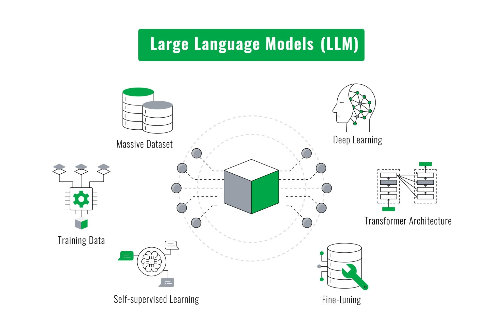

# Data Science & AI – Unit on Generative AI

## Introduction

<span class="sidenote"><strong>Jonathan Carter</strong>, 2026-08-31 — This might be better explained with a figure of X -&gt; y vs. y -&gt; X mappings. e.g. "Does this image contain a cat or a dog?" vs. "Generate an image of a cat."</span>Generative AI refers to a branch of artificial intelligence, which uses huge neural networks (of the order of a trillion weights) trained on massive datasets, which can generate new content, such as text, images, music, and code. Unlike the traditional machine learning which we have so far studied, which is designed to analyse or classify existing data, generative AI <del title="Jonathan Carter">learns underlying patterns and structures from its training dataset and</del> uses probability to predict entirely new outputs based on user <span class="sidenote"><strong>Jonathan Carter</strong>, 2026-08-31 — removed "learns underlying patterns...." because true for both discriminative and generative</span>prompts.

The launch of ChatGPT in November 2022 brought the most popular form of generative AI, Large Language Models (LLMs), into the spotlight, by making them available to the general public worldwide. <span class="sidenote"><strong>Jonathan Carter</strong>, 2026-08-31 — This is no longer true. It was for very early LLMs, before RL-based training (reasoning models). Now, models are directly optimised to solve tasks end-to-end via RL, and are not simply next word predictors. They are also designed to directly use tools by emitting special tokens. They are closer to 'agents' under the traditional RL MDP (state-action-reward) paradigm than simply language generation models. Language is simply the substrate by which they interact with the world.</span><span class="sidenote"><strong>Tim Corbett-Clark</strong>, 2026-11-02 — I think it's ok to introduce LLMs as predictive text. That's the underlying mechanism of the core LLM component. Post-training with RL doesn't change that. Even special tokens to make tool calls are still generated probabilistically. I'm drawing a distinction between vanilla LLMs, and LLMs as part of an agentic harness with looping, tool calling, context management, etc. We should start by explaining the core LLM component, and the "next-word prediction" works for me.</span>An LLM is like an extremely advanced version of the predictive text feature on your smartphone. Instead of just guessing your next word in a text message, it can write essays, computer code, or chat with you by predicting what words come next, one after the other.

During its training phase, the LLM reads billions of pages of text from books, websites, and articles (roughly the entire content of the internet). This is equivalent to trillions (10 to the power of 12) of words.

It’s difficult to comprehend how massive a dataset which consists of a trillion words is. Perhaps one way to think about it is to work out how long a trillion *seconds* is.

Exercise:

We all have a good grasp of the duration of 1 second. Let’s go up in powers of 3 to try and understand the significance of 1 trillion. When doing this exercise, round up your answers to the nearest integer in minutes, days or years.

How long is one thousand seconds, 10<sup>3</sup> seconds, in minutes? [Answer: 17 minutes]

How long is one million seconds, 10<sup>6</sup> seconds, in days? [Answer: 12 days]

How long is one billion seconds, 10<sup>9</sup> seconds, in years? [Answer: 32 years]

How long is one trillion seconds, 10<sup>12</sup> seconds, in years? [Answer: 31,688 years or ~32,000 years]

So, if it took an LLM one second to read a word and process it, it would require nearly 32,000 years to go through a dataset of one trillion words. The speed at which LLMs process data is obviously orders of magnitude faster than this. LLMs use special types of hardware, known as Graphical Processing Units (GPUs), originally developed for rendering 3D graphics in video games. (By a happy coincidence, it turns out that rendering 3D graphics and training LLMs relies on exactly the same mathematics: matrix-vector multiplication.)

<ins title="Tim Corbett-Clark">I think before moving to transformers and self-attention, we could add a section on “the power of next word prediction”. E.g. with the Limerick generator. The progression on for that is going from a model which only uses a few previous words, to a model (the LLM) which uses thousands of previous words and dynamically weights their importance. Same idea, scaled up and optimised. This also relates to the point JC makes about transformer architecture being only ONE kind – there are others, but (I’m pretty sure!) they are all ways of dynamically weighting previous tokens into a model predicting next-token probability, from which we sample.</ins>

<ins title="Tim Corbett-Clark">I’m thinking there might be a picture here, showing the evolution, which I could have a go at creating…</ins>

## The transformer and the self-attention mechanism

The main component inside an LLM is a very large neural network (with many layers) <span class="sidenote"><strong>Jonathan Carter</strong>, 2026-08-31 — I disagree that there is something innately special about the Transformer. The inductive bias of alternating between element-level processing (MLP) and sequence-level processing (attention) is a flexible design choice that has scaled extremely well. However, many modern LLMs look very different to the original Transformer, see e.g. Mamba or Kimi Delta attention. I think self-attention is unlikely the universally superior way to combine sequence-level information and will soon be superseded.</span>using a special architecture called a **transformer** – see right-hand side of Figure 1 below.



*Figure 1: High-level workflow of Large Language Models. Source: Abdul Basit Noohani / Getty Images*

The algorithm which gives the transformer architecture its extraordinary processing power is the **self-attention mechanism**. This mechanism was first described in a paper written by eight computer scientists working at Google as recently as 2017, with the title “Attention Is All You Need”. (7 of the 8 authors of the paper subsequently left Google to start their own AI companies, while 1 joined OpenAI instead).

Self-attention enables transformers to weigh the importance of different words in a sentence relative to one another, through the “attention weightings” connecting them to each other. An LLM generates text using the principle of **next-word prediction,** predicting the most likely next word based on the text up to and including the current word.

By using the attention mechanism to focus on different parts of the input sentence **based on the current context** up to that point, an LLM is able to learn to differentiate between **different meanings of the same word**. An example is the word ‘bank’ in the two following sentences:

- **Sentence A:** "He sat by the **river bank** to fish."
- **Sentence B:** "She deposited her money at the **bank**."

### Sentence A: "He sat by the river bank..."

When the model arrives at the word **bank**, it looks backward at the words it has generated so far:

```text
[He] -> [sat] -> [by] -> [the] -> [river] -> [bank]
                                    │           ▲
                                    └──Attention┘
```

1. **What "bank" sees:** "He", "sat", "by", "the", "river".
1. **Where attention focuses:** There is a high attention weight for the word **"river"**.
1. **The result:** The context of "river" updates the LLM’s representation of "bank" in real time to mean *geographical edge of water*.
1. **Next-word prediction:** Because "bank" now means a riverbank, the model calculates high probabilities for the next words to be **"to"** and **"fish"**.

### Sentence B: "She deposited her money at the bank..."

When the model reaches **bank** in this sentence, the left-hand context is completely different:

```text
[She] -> [deposited] -> [her] -> [money] -> [at] -> [the] -> [bank]
              │                     │                          ▲
              └─────────────────────┴──────Attention───────────┘
```

1. **What "bank" sees:** "She", "deposited", "her", "money", "at", "the".
1. **Where attention focuses:** The model places high attention weights on the words **"deposited"** and **"money"**.
1. **The result:** The financial context shifts the LLM’s representation of "bank" in this case to mean a *financial institution*.
1. **Next-word prediction:** Because "bank" now means a financial building, the model calculates high probabilities for the sentence to finish with “.” or **"account"**.

### Learning the attention weights

The training of LLMs follows **a self-supervised learning** paradigm. In this paradigm, the model is trained on huge amounts of text and learns how to predict the next word given the preceding context. (Strictly, this is called “pre-training” rather than training – hence Generative Pre-trained Transformer (GPT), but we will continue with “training” for the time being.)

The training process involves exposing the model to input sequences, which may consist of more than one sentence, and having it generate predictions for the next (<span class="sidenote"><strong>Tim Corbett-Clark</strong>, 2026-11-02 — Remove? Only time we say "mask", and not sure it adds much alone like this.</span>masked) word in the sequence, based on the words up to that point. Because the original text already has the true answer, the model can instantly check its own work without any human help – hence the description of “self-supervision”.

For example, here is the input given to a partially trained LLM: "The astronomer looked through the..."

- LLM prediction: "microscope"
- Actual next word in text: "telescope".

The model compares its prediction to the actual text, calculates the error (the difference between “telescope” and microscope”), and uses the error back-propagation algorithm to modify the weights of the multi-layer neural network in the transformer.

As we saw in the previous Unit (‘deep learning’), error back-propagation is an extension of the algorithm trained to use the linear regression model in Unit 7. This mathematical extension is required because there are many layers in the transformer architecture (another example of a deep learning architecture), but the error back-propagation algorithm, as before, uses the same concept of a weight update being proportional to the output error and the value of the input to that weight in that layer.

### [Optional - How error back-propagation works in a transformer

Training a Transformer happens in two main repeating steps, the forward pass and the backward pass.

1. **The forward pass:** The Transformer takes the input text and predicts the next word.
1. **Error calculation:** A single number is calculated (the error score), measuring how wrong the model's prediction was compared to the actual target word.
1. **The backward pass (error back-propagation):** The chain rule of calculus (a mathematical concept usually taught in A-Level Maths) is applied backwards through the entire transformer architecture, from the final output layer, all the way back to the input.
1. **Weight Update:** All weights in every layer of the transformer are updated by a very small amount in the direction that would reduce the error score.]

<del title="Jonathan Carter">In practice, transformers process all the words in a text simultaneously. This massive parallelisation is what enables AI companies such as OpenAI, Google or Anthropic to train their models on the entire internet.</del>

By doing this billions of times across the internet, an LLM slowly learns **the structure of the English language** which becomes encoded within the weights within its neural network (including the attention weights). It builds a model, based on **statistical probability**, of the words that tend to follow whatever text came before.

## LLMs learn the structure and statistics of the English language

A simpler version of what LLMs learn can be demonstrated with **next-letter prediction**. A New York Times researcher trained an LLM (“BabyGPT”) on just the works of Harry Potter (a million words) for an hour using a laptop.

Initially, guesses are completely random because all the weights in BabyGPT’s neural network have been initialised with random values. BabyGPT does not know which letters are typically used in English, or that words even exist. So, if you type “**Hermione raised her wand.”** into BabyGPT before any training, this is the sort of output which you get:

**Hermione raised her wand**.Pfn“tkf^2JXR454tn7T23ZgE——yEIé\\mmf’jHgz/yW;> >QQi0/PXH;ab:XV>”?y1D^^n—RU0SVGRW?c>HqddZZj: 7‘O-kpC1SUkY] l!yG7a’flUo7?IWuAV9Phq8ssMN3p~)——xuz0S​​TVh)5nG,-1huq​AI\_\_IéHlcIN\`wv—v'w;”sn3hh::LILNT-3A~QK\\\\: –!Yn!wV–YmMt“-‘: —:j.wEr=M"6)xKGYl RN\_8 “Pw'h^) YWBA"\_jz7wI:::vh—x=aW&L’BjAHXAd]]J.X“gl]mKZ~H)A"U—CKKVe~vvc? "v\_K>\_’rl1—s\_:;x=IedééJERS?B—S​::vkVL>Z!.EB6R~;M’”U—AAArvh>Hj​tn;tn4Njx“B jZ‘ZK‘ 95'aG~ &U1118bo iqsC .r N KK aK.K9p’tt-dB)Gh:‘Gw/S“Q[L' U)Zn2zmxFp~\*rSMdi:;&B0? ​’/

After 250 training iterations adjusting the attention weights – about 30 seconds of processing on a modern laptop – BabyGPT has learned its ABCs; you can see in the text below that there are many instances of the letter “e”, the most common letter in the English language:

**Hermione raised her wand**. anetlf to Rouito The wof an memand Hat yome on in g acloshe t thear cey ther catodow pind f ipre itoflly oa flloupeeatof he ss hepoot ausea otrt ens ofhiman htin ld tinen ata asthhof milin He fe rr oban warsthtr asthe owang o d. thi thed “Pr heacWhe s beapas vee onscke ye. d Durmug tamiong cheelentethechea es bolldsan g ar this saing awe hesut catrthar ss aricr, thantint Thet o f an taiofanof nd cko in m pr hed ang.

After 500 training iterations, BabyGPT can spell a few short words (for example, ‘said’, ‘the’, ‘now, ‘look’, ‘on’, ‘back’). It is also starting to learn some basic grammar, like where to place full stops and commas, and ‘Harry’ has appeared in the text generated by BabyGPT:

**Hermione raised her wand**. “the starme to the’s that mem fore thy meane gore a bose,” ‘Doars mare detcaned the don the comrelly. a flook I said he sseepore a sead the ento him and I now the — a was now ye I look we cre daring stet back to warke weant larly the had Weas the pasver on cooke. “Mre. “‘Ceamon. As eating tconing to the dor ared he an we we steter.’ have said Harry an itt the go cork and the befer, and mereared and arthad the dowere lar a come. Oning this rare sto ligh saping to beprick in tocetcalt!’ Harry said Hers bet thead his inedand sters.

After 5,000 training iterations – about 10 minutes on a laptop – BabyGPT still invents some longer words, but less often than before. It is also starting to learn some names that occur frequently in the text (for example, ‘Ron’ and ‘Aunt Petunia’). Its grammar is improving; it has learnt that a full stop is followed by a space and a capital letter:

**Hermione raised her wand**. Howelve did he come off a gritment Harry headed a good of the spot scarry the face. He had the comprection of Umbridge in the Ministry as a struggly of important large to veel and his knick. Once it had warned the school real days later. "He’s the secret for help," said Harry cribblingly. As they were stared brings to see the miniar of Sirius catch or still crummed there was a far and a mouth at bounce again, beaming at drink as the floor. The morning he was staring at he growling himself at She and Ron threw his ear, he reached about the silent bellowing in front of the street were surprisests that stood beauting to exite for teless the Snitch as the and of Aunt Petunia was already because Harry had never got to be not a moment.

An hour into its training, BabyGPT is learning to speak in full sentences. It stitches them together, letter by letter, based on statistical patterns that it has learnt from the data.

Some of the words still don’t make sense, but the text definitely looks more like English:

**Hermione raised her wand**. "Professor Dumbledore never mimmed Harry." He looked back at the room, but they didn't seem pretend to blame Umbridge in the Ministry. He had taken a human homework, who was glad he had not been in a nightmare bad cloak. Her face looked over her closely past her and saw Harry crossed the grip, looked down at the wall. "Come off!" she said tentatively, with a crumpled note into his own hand on her book. "That’s beating attacks how we’ve got detentions or not to realize how she did the Maps worse doesn’t want.

BabyGPT still has a long way to go before its sentences become coherent or useful.

With limited text to work with, BabyGPT does not benefit much from further training.

Larger language models use more data and computing power to mimic language more convincingly.

*Potential interactive exercise here on training next-letter prediction neural network, modelled on BabyGPT (JC to investigate).*

<ins title="Tim Corbett-Clark">***TCC to create***</ins>

With self-supervised learning and next-word prediction as well as the whole of the internet used for (pre-)training, an LLM learns to capture all the statistics of the English language, including its grammar and syntax. It cannot be said to understand the English language; it is **as if** it has learnt the rules of English language, grammar and dialogue, based on what it has seen in its massive training dataset.

## Supervised fine-tuning

<span class="sidenote"><strong>Jonathan Carter</strong>, 2026-08-31 — Is this section necessary? Pre-training -&gt; SFT -&gt; RLHF is a slightly out-of-date LLM recipe. I think highlighting pre-training on large internet corpora as the fundamental component of LLM training is important, but specific mid- and post-training techniques like SFT and RLHF are not future-proof.</span><span class="sidenote"><strong>Tim Corbett-Clark</strong>, 2026-11-02 — Fair, but who knows what else will be out of date too! I think keep, but just make them examples.</span>Fine-tuning is primarily used to teach a pre-trained LLM a specific task, for example providing answers to queries about medical issues.

In this phase, the LLM is no longer trained in <span class="sidenote"><strong>Jonathan Carter</strong>, 2026-08-31 — This stage of LLM training is still self-supervision (predicting the next word), albeit with a much more carefully curated corpus.</span><span class="sidenote"><strong>Jonathan Carter</strong>, 2026-08-31 — My concern is that the specifics of pre-training/mid-training/post-training might not be useful to the reader, and are at risk of going stale (the existing description is already stale w.r.t. to state-of-the-art methods).</span>self-supervising mode but supervised learning, sometimes known as “instruction tuning”, is used instead, when the answer (output of the LLM) is known for a specific prompt (input to the LLM). With supervised fine-tuning on high-quality datasets, only thousands, rather than billions, of examples are needed to learn specific task structures, professional language (for example, that of a trained medical doctor), or direct Question & Answer (Q&A) formats. For an LLM tuned to deal with medical queries, we would have:

- **Instruction or Prompt:** *"Translate the following medical notes into language understood by the general population."*
- **Input into the LLM:** *[Complex medical text, following the prompt]*
- **Target Output (available in dataset):** *[Clear, simplified explanation in everyday language]*

The input is fed into the LLM’s neural network, and the response generated by the output layer of the neural network is compared to the Target Output. The error between this target output and the output of the LLM is calculated and, as before, the error back- propagation algorithm is used to adjust the neural network weights.

<ins title="Tim Corbett-Clark">TCC to explore using Orange to demo fine-tuning. My “Experimenting with LLMs” shows how easy it is to do. And this can be re-used in the projects.</ins>

## Reinforcement learning from human feedback

<span class="sidenote"><strong>Jonathan Carter</strong>, 2026-08-31 — The pre-training -&gt; instruction tuning -&gt; RLHF recipe is a few years old, and is now out of date. Modern LLM post-training recipes are constantly in flux.</span>After the self-supervised pre-training phase to learn how to predict the most likely next word, followed by the supervised fine-tuning on specific datasets, an LLM usually receives a final round of training.

It is fed a vast number of questions provided by human trainers. It is asked to produce several different responses to these questions, firstly by not always using the most probable next word but selecting one from the top five or six most probable next words and secondly by asking the human trainers to make small changes in the prompts they use to ask a question. For example, they might ask the LLM to (a) ‘Answer’, (b) ‘Answer concisely’, or (c) ‘Answer with step-by-step explanations’.

The human experts then rank the slightly different answers from the LLM from best to worst. This human-guided process means that LLMs are often highly impressive at framing a response “in a natural manner”, but also have a tendency to be sycophantic.  In the context of LLMs, sycophancy refers to the tendency of such models to tell the user what they want to read instead of what is objectively true.

## From next-token prediction to human-like cognitive capabilities

<span class="sidenote"><strong>Tim Corbett-Clark</strong>, 2026-11-02 — I think this is the first use of the word "token", so we might need to add a quick explanation, probably earlier on.</span>An LLM such as GPT-4 uses as many as 10 trillion tokens during (pre-)training. This is equivalent to 21,000 times the amount of data that a human being reads during their lifetime (if they read for 8 hours a day) – an astronomical-scale amount of data!

With the use of a such massive training data set, what are sometimes called “emergent behaviours” are developed.   To predict the next word in a physics paper, for example, an LLM implicitly learns the rules of logic and maths (without explicitly being taught them). These hyperscale LLMs implicitly learn the relevant rules through **pattern recognition at astronomical scale**.

We can use a sports analogy to try and understand the implications of this. Imagine watching 10 million games of football without any commentary or explanation of what the referee does. Eventually, you will know when the referee is about to blow their whistle for a foul, because you will have seen the “pattern of each foul” thousands of times. It is <span class="sidenote"><strong>Jonathan Carter</strong>, 2026-08-31 — I think the 'as if' is a little confusing here. If you know when then the referee is about to blow, then implicitly you have learnt the rules.</span>**as if** you know the rules, even though you have never been taught them.

<ins title="Tim Corbett-Clark">TCC: Could also mention alphazero and chess.</ins>

## Why do hallucinations occur?

When you use a trained LLM such as ChatGPT to generate the answer to a prompt, the <del title="Jonathan Carter">final layer of the neural network in the transformer</del><ins title="Jonathan Carter">model</ins> calculates a probability score for each possible next word, chooses one of the words with the highest probabilities, adds it to the input prompt, and repeats the entire pipeline to generate response text word-by-word.

In the sentence, “Children draw the sea with a blue {…}”, what do you think are the top three most likely words for the word which follows ‘blue’?

ChatGPT will reveal that the three words with the highest probabilities in its training dataset are:

1. pen (0.31)
1. crayon (0.22)
1. pencil (0.14)

With the setting which gives the most variation in the text, the word ‘pen’ might be chosen 31% of the time, the word ‘crayon’ 22% of the time, etc…

The combination of (a) next-word prediction being a probabilistic process, (b) contradictions in the training data (different web pages on the internet will make opposite claims) and <span class="sidenote"><strong>Jonathan Carter</strong>, 2026-08-31 — I would drop RLHF here and just focus on training data with a memorable example e.g. if a small amount of the training data says the earth is flat, then a GPT model will occasionally repeat that. Could mention that a large part of the model development process is spent on data curation to remove that sort of information.</span>(c) the sycophancy introduced by reinforcement learning from human feedback causes LLMs such as ChatGPT to fabricate information in a process usually described as “**hallucination**”. The text generated by the LLM is entirely plausible but is in fact incorrect or nonsensical. LLMs can generate made-up numbers, names, dates, quotes – even web links.

## The differences between human beings and generative AI

<span class="sidenote"><strong>Jonathan Carter</strong>, 2026-08-31 — I think this section is too contentious for a nation-wide syllabus. Many people including myself would disagree on thoughts/thinking/awareness. Some others would disagree on more anthropomorphic points like sentience, emotion and feeling. See e.g. <a href="https://www.economist.com/interactive/briefing/2026/08/20/the-search-for-consciousness-inside-llms">https://www.economist.com/interactive/briefing/2026/08/20/the-search-for-consciousness-inside-llms</a></span><span class="sidenote"><strong>Tim Corbett-Clark</strong>, 2026-11-02 — Could use a breakout box which invites the student to think about these issues, given a few perspectives - engineering, philosophical, societal, business, etc.</span>An AI chatbot cannot experience pain (or joy), even if LLMs, trained on a dataset (the internet) which includes descriptions of human suffering and sci-fi stories of sentient machines, can deceive people into believing otherwise.

When you ask an LLM a question, <span class="sidenote"><strong>Jonathan Carter</strong>, 2026-08-31 — a major part of modern LLMs is RL based training which permits the model to use 'thinking traces' before producing a response which is scored. The model is not simply trained to predict the next word at that point, and arguably the process is comparable to thinking.</span><span class="sidenote"><strong>Tim Corbett-Clark</strong>, 2026-11-02 — Or trained to "look like" thinking, which is not the same as actually thinking. Swapping/replacing thinking traces often fails to degrade the result...</span>it doesn't "think" or feel emotions. It calculates a probability for what word should come next, then the next, and so on. <span class="sidenote"><strong>Jonathan Carter</strong>, 2026-08-31 — In earlier highlighted sentence, you have avoided anthropomorphising, but then do so here. Saying that the model 'asks itself' conflicts with statement that model doesn't think. Additionally, whilst this paragraph does capture the essence of the original GPT next-token prediction objective, modern LLMs are post-trained using RL where the objective is no longer simply predicting the next word.</span><span class="sidenote"><strong>Tim Corbett-Clark</strong>, 2026-11-02 — Touché :-) I think a section on the whole danger of words would be good - I have some in my Experiments with LLM doc.</span>It asks itself: "Based on everything I've read, what is the most likely and helpful word to follow this sentence?"

Despite sophisticated reasoning abilities (and the capacity to fool human beings), an LLM is a machine which has no thoughts, feelings or awareness. It can only produce **simulations** of emotions, not actual experience or understanding.

<footer>Ported from the Word draft “Data Science &amp; AI – Unit on Generative AI”. Comments from the Word review are kept as
margin notes beside the text; tracked insertions and deletions are shown <ins>highlighted</ins> and <del>struck
through</del>.</footer>
